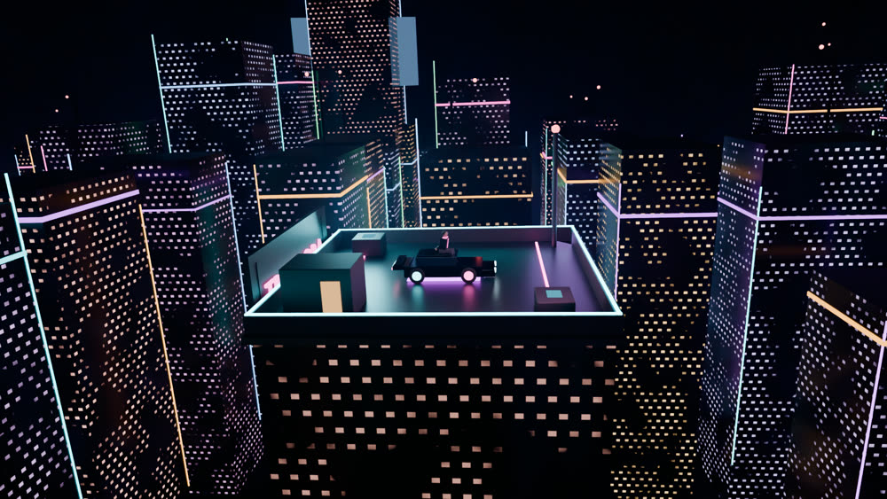

# TRACEORA — See it. Trace it. Create it.

This is a native Android Kotlin/Jetpack Compose MVP foundation for TRACEORA.

## Included working flows
- Compose-based Home / Explore / Create / Lessons / Profile navigation
- Runtime camera permission
- CameraX rear-camera preview
- Camera-overlay tracing workspace
- Pinch zoom, pan and rotation gestures for the reference
- Adjustable overlay opacity
- Grid toggle
- Lock/unlock reference
- Reset transform
- Local artwork persistence using Room
- Gallery-backed artwork metadata
- Device-compatible offline-first structure
- ARCore dependency included for extending the camera workspace to world-anchored tracking

## Important implementation note
The supplied project deliberately keeps the core camera-trace experience usable on devices without ARCore. Full ARCore plane tracking/world anchoring is the next device-specific layer; the fallback camera overlay remains the default reliable path.

## Build
Open the `Traceora` folder in Android Studio, allow Gradle sync, then run on an Android device with a rear camera.

For production release, add:
- a real ARCore Session/plane-anchor renderer
- actual edge/outline processing using RenderScript replacement/OpenCV/ML or GPU image processing
- persisted user settings with DataStore
- complete lesson/achievement tables
- Android Sharesheet capture/export pipeline
- Play Billing product IDs
- accessibility audit
- automated UI/device tests
- crash reporting and analytics
- privacy/terms screens and account deletion


## Phone-only APK build
This project includes a GitHub Actions workflow. Upload the project to a GitHub repository from your phone, open Actions, select **Build TRACEORA APK**, and tap **Run workflow**. GitHub builds the APK in the cloud. Download the `TRACEORA-debug-apk` artifact and install `app-debug.apk` on Android. The core app is designed to work offline after installation.

---

## Neon cyberpunk city — drone shot (Blender + GitHub Actions)

`render/neon_cyberpunk_city.py` is a fully procedural Blender scene: a car parked
on a rooftop, a man sitting on the car, and a slow drone flyby/orbit through a
neon skyline. No external assets — buildings, window grids, neon strips, haze,
camera path and figure are all generated in code.

### Watch / download the finished shot
**Direct MP4 download (no login needed):**
https://github.com/Ans-to/TRACEORA1/releases/download/cyberpunk-city/neon-cyberpunk-city-drone.mp4

1920x1080 · 24 fps · 150 frames (6.25 s) · Cycles, 20 samples with OpenImageDenoise ·
rendered on 6 parallel GitHub runners in about an hour.



### Re-render it yourself
1. Open **Actions → Render Neon Cyberpunk City (drone shot) → Run workflow**.
2. Pick the frame range, resolution, samples, engine and shard count.
3. When it finishes, the run summary links the MP4, and the file is also
   attached to the `cyberpunk-city` release as a stable download URL.

The shot is split across parallel runners ("shards"), because a path-traced
1080p animation is far too slow for a single runner: 150 frames × 6 shards
finishes in well under an hour.

### Render locally (same command CI uses)
```bash
blender -b --factory-startup --python render/neon_cyberpunk_city.py -- \
  --render --out frames --res 1920x1080 --samples 20 --frames 1-150
```
Then encode, with the same bloom + grade the workflow applies:
```bash
ffmpeg -framerate 24 -i frames/frame_%04d.png \
  -filter_complex "[0:v]split=2[a][b];[b]gblur=sigma=22:steps=3,colorlevels=rimin=0.55:gimin=0.55:bimin=0.55[g];[a][g]blend=all_mode=screen:all_opacity=0.5[m];[m]eq=contrast=1.07:saturation=1.16,vignette=angle=PI/4.5[v]" \
  -map "[v]" -c:v libx264 -crf 18 -pix_fmt yuv420p -movflags +faststart neon-cyberpunk-city-drone.mp4
```

Options worth knowing: `--profile thin_hero|thin|full|none` trades atmospheric
haze for speed, `--variants` renders one frame across every profile to compare
look/timing, and `--shot A-B` sets the camera path range while `--frames A-B`
renders just a slice of it (that is how sharding works).

`render/ci-run.json` is the parameter file used by the push trigger (`render: false`
means "validate the scene only"), and `render/preview/` holds the review stills the
workflow commits back. A failing shard also commits its Blender log there so a
headless failure can be diagnosed without downloading logs.
